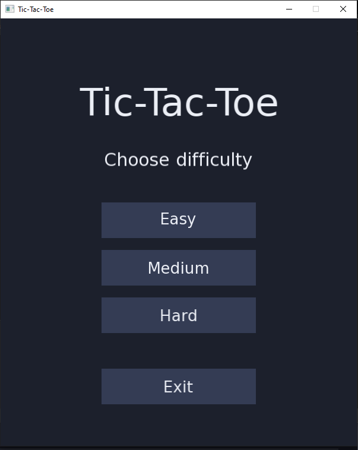
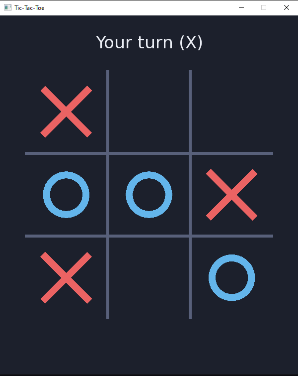
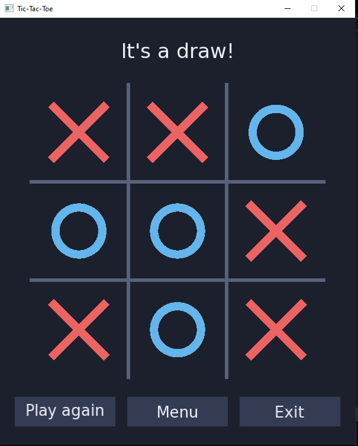
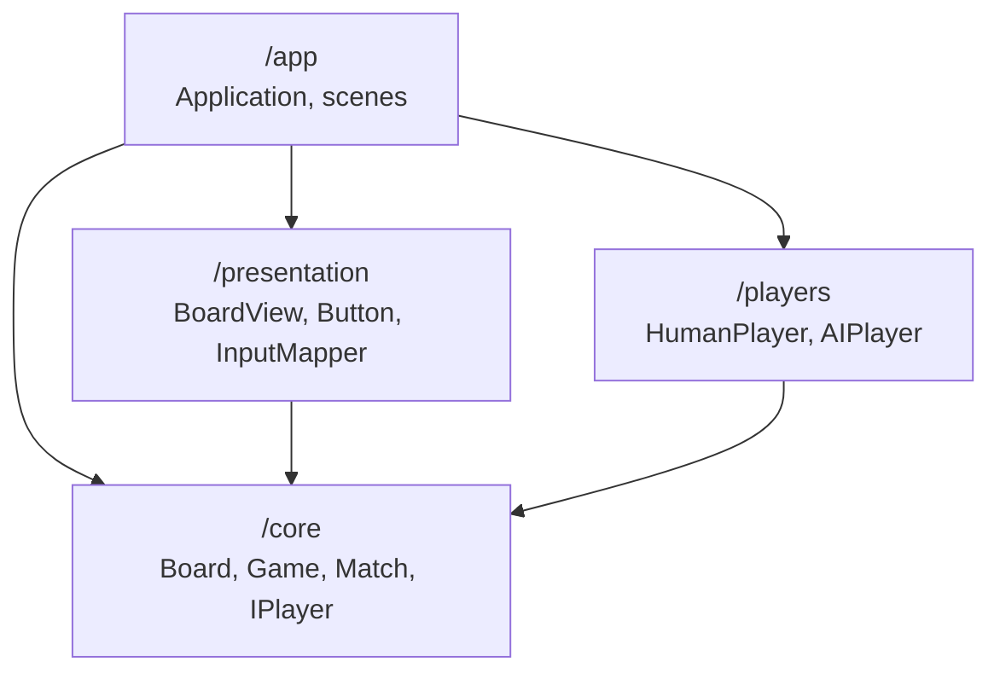

# TicTacToe

A Tic-Tac-Toe game for Windows written in C++ (C++ 17) with [SFML 3](https://www.sfml-dev.org/).
Play against an AI with three difficulty levels, from random moves to an unbeatable minimax opponent.






## Features

- Click-to-play against an AI opponent (you are **X** and move first)
- Three difficulty levels: **Easy**, **Medium** and **Hard**
- Following **SOLID** principles, including abstraction and encapsulation
- Salability taken into account

## Quick start

### Requirements

- Windows 10/11, x64
- [Visual Studio](https://visualstudio.microsoft.com/) with the **Desktop development with C++** workload
- [CMake](https://cmake.org/download/) 3.21 or newer (`winget install Kitware.CMake`)

SFML 3.0 binaries for MSVC x64 are bundled in `dependencies/`, so there is nothing else to install and
no internet connection is needed to build or play.

### Run directly (ZIP file)
1. Go to the last [Release](https://github.com/mikygt21/TicTacToe/releases) and download the [.zip folder](https://github.com/mikygt21/TicTacToe/releases/download/v1.0.0/TicTacToe-v1_0_0-win64.zip) with the executable file.
2. Unzip and run as is.

### Build and run (source code)

From a terminal in the repository root:

```bat
cmake -B build
cmake --build build --config Release --target TicTacToe
build\Release\TicTacToe.exe
```

The build copies the SFML DLLs and the `Assets` folder next to the executable.
Use `--config Debug` and `build\Debug\TicTacToe.exe` for a debug build.

### Using Visual Studio

There are two ways to work in the IDE:

1. **Generated solution (recommended).** After running `cmake -B build`, open `build\TicTacToe.sln`.
   It contains two projects: `TicTacToe` (the game, set as startup project) and `TicTacToeTests`.
   Press **F5** to run. Re-run `cmake -B build` after adding or removing source files and
   updating `CMakeLists.txt`.
2. **Hand-written project.** Open the root `TicTacToe.sln`, select the **x64** platform and press **F5**.
   This project file targets the `v145` toolset (Visual Studio 2026); on an older Visual Studio use
   *Project → Properties → Platform Toolset* to pick the installed one. It does not include the tests,
   and new source files must be added to it manually.

## How to play

| Action | Control |
|---|---|
| Place your mark | Left-click an empty cell |
| Choose difficulty / buttons | Left-click |
| Quit | Close the window, or use the *Exit* button |

| Difficulty | Behaviour |
|---|---|
| Easy | Plays a random legal move |
| Medium | Takes a winning move if available, blocks yours if needed, otherwise plays randomly |
| Hard | Minimax search: it never loses (the best you can get is a draw) |

When a match ends, the result is shown together with three buttons:
*Play again*, *Menu* (change difficulty) and *Exit*.

## Running the tests

The tests have no SFML dependency. With the CMake build already configured:

```bat
cmake --build build --config Debug
ctest --test-dir build -C Debug --output-on-failure
```

You can also run a single suite directly: `build\Debug\TicTacToeTests.exe core|ai|ui`.

The suites cover the rules (`core`), the AI in every difficulty, including an exhaustive check that
**Hard never loses** (`ai`), and the pixel-to-cell input mapping (`ui`).

To build only the tests, without SFML:

```bash
cmake -B build -DTTT_BUILD_GAME=OFF
cmake --build build
ctest --test-dir build --output-on-failure
```

## Project structure

```text
TicTacToe/
├── Assets/fonts/        Bundled font and its license
├── dependencies/        Prebuilt SFML 3.0 (MSVC x64): bin/, include/, lib/
├── docs/                Architecture diagrams
├── src/
│   ├── core/            Rules and core entities (Board, Game, Match, IPlayer).
│   ├── players/         IPlayer implementations (HumanPlayer, AIPlayer).
│   ├── presentation/    Drawing and input helpers (BoardView, Button, InputMapper, UiConfig)
│   ├── app/             Window, main loop and scenes (Application, MenuScene, GameScene)
│   └── main.cpp
├── tests/               Unit tests
├── CMakeLists.txt       Main build definition
└── TicTacToe.sln        Hand-written Visual Studio project (original code)
```

## Architecture



Dependencies only point towards `core`, which knows nothing about SFML, input or drawing.

- **`IPlayer` abstraction.** A player is polled once per frame and returns a move or "not yet".
  `Match` connects a `Game` with two players and never knows whether they are a person or an AI.
- **Single responsibility.** `Board` stores cells, `Rules` detects a winner, `Game` enforces turns,
  `BoardView` only draws, `InputMapper` only converts pixels to cells.
- **Scenes.** `Application` runs the loop and delegates to one `IScene` at a time.
  Scenes request transitions through the small `ISceneNavigator` interface.

For more details, class and sequence diagrams can be found in [docs/architecture.md](docs/architecture.md).

## Customization

- **Colours, window size and board position:** `src/presentation/UiConfig.h`.
- **Font:** place a `.ttf` in `Assets/fonts/`, change the file name in `src/app/Application.cpp`
  and keep the font's license file next to it. Update the acknowledgements below if you change it.
- **New difficulty:** add a value to `Difficulty` and a branch in `AIPlayer::chooseMove`.
- **New source files:** add them to the lists in `CMakeLists.txt` (and to `TicTacToe.vcxproj` if you
  use the hand-written project).

## Troubleshooting

| Problem | Fix |
|---|---|
| `cmake` is not recognized | Open a new terminal after installing CMake, or use *Developer PowerShell for VS* |
| `Asset not found` at startup | Run the game from its build folder (`build\Release`), where `Assets` is copied, or use the CMake build |
| Missing `sfml-*.dll` when starting the exe | Build through CMake (it copies the DLLs) or start it from Visual Studio |
| Visual Studio cannot find platform toolset `v145` | Retarget the project to your installed toolset, or use the CMake route, which detects it automatically |

## Roadmap (hopefully)

- [ ] Local two-player mode (two `HumanPlayer`s, new menu entry)
- [ ] Highlight the winning line
- [ ] Sound effects
- [ ] Network multiplayer through a `RemotePlayer`

## License

Released under the [MIT License](LICENSE.txt).

## Acknowledgements

- [SFML](https://www.sfml-dev.org/) 3.0, licensed under the zlib/libpng license.
  Portions of the graphics module rely on FreeType: *Portions of this software are copyright © The FreeType Project (www.freetype.org). All rights reserved.*
- Font bundled in `Assets/fonts/` (currently DejaVu Sans). Its license is in the same folder.
