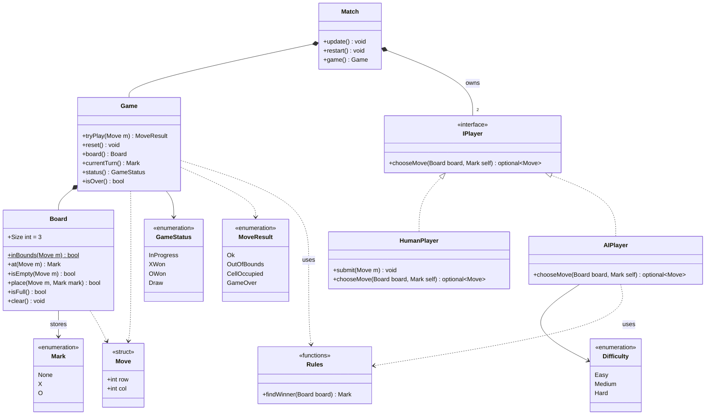
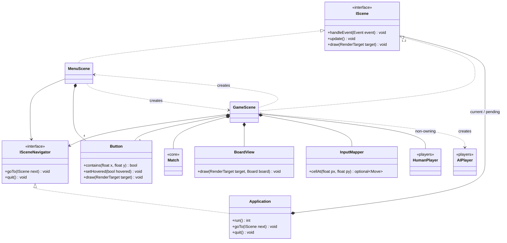
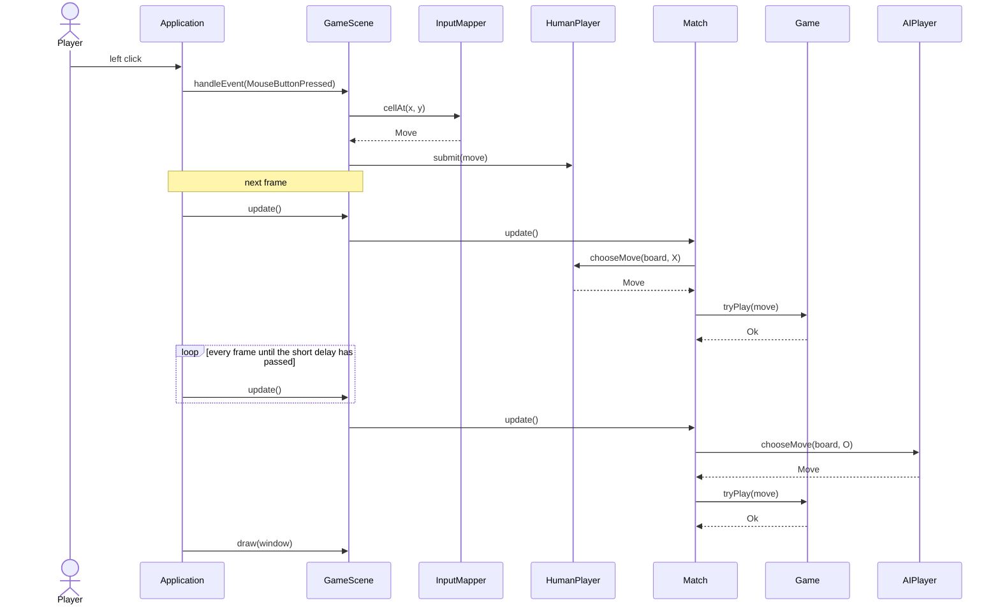

# Architecture

Code organization and development focused in complying SOLID principles. 
The diagrams are written in [Mermaid](https://mermaid.js.org/).

## Layers and the dependency rule

The code is split into four folders. **Dependencies only point downwards**:
`core` knows nothing about the other layers, and only `presentation` and `app`
know about SFML.

| Folder | Responsibility | SFML dependency |
|---|---|---|
| `src/core` | Game state and rules (`Board`, `Game`, `Rules`, `Match`) and the `IPlayer` abstraction | No |
| `src/players` | Implementations of `IPlayer`: `HumanPlayer`, `AIPlayer` | No |
| `src/presentation` | Drawing and input helpers (`BoardView`, `Button`, `InputMapper`, `UiConfig`) | Mostly (`InputMapper` and `BoardLayout` are SFML-free) |
| `src/app` | Window, main loop and scenes (`Application`, `MenuScene`, `GameScene`) | Yes |

Because `core` and `players` are free of SFML, they are covered by unit tests
that run without opening a window.

## Class diagrams

### Domain: `core` and `players` (no SFML)

`Move` is the value type passed around everywhere (`Board`, `Game`,
`IPlayer`, `HumanPlayer`, `AIPlayer`); only two of its arrows are drawn to improve diagram readability.

### Application and presentation (SFML)

Notes:

- `BoardView` and `InputMapper` both take a `BoardLayout`, so drawing and click detection always
  agree on the geometry.

- `Match`, `HumanPlayer` and `AIPlayer` are shown collapsed; their details are
  in the domain diagram above.
  
- `UiConfig.h` (colours, window size, board position) and `TextUtil.h` are
  shared helpers used across `presentation` and `app`; they are left out to keep
  the diagram readable.
  
- `Rules` is a set of free functions, shown as a class only for convenience.

- `main()` creates one `Application` and calls `run()`.

## Sequence diagram: one human move and the AI reply

`Match::update()` polls the current
player once per frame, and `std::nullopt` means "no decision yet". That is why
the same loop works for a mouse click and an AI, or (hopefully in the future) a
network opponent.
